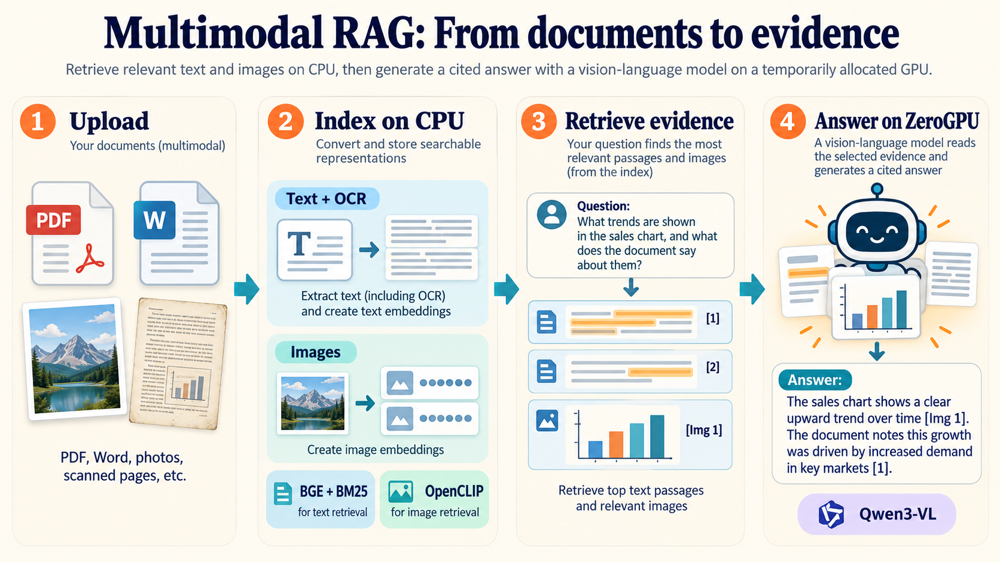

# Multimodal RAG

**Ask questions over documents, images, scans and charts — and inspect the evidence behind the answer.**

[**Open the live Gradio demo**](https://huggingface.co/spaces/Angshul/Multimodal-RAG) · [Working Space source](https://huggingface.co/spaces/Angshul/Multimodal-RAG/tree/main) · [GitHub Pages setup](#publish-the-github-pages-guide) · [Tutorial and Medium edition](#tutorial-and-medium-edition)



**Angshul Majumdar** · Indraprastha Institute of Information Technology Delhi · [angshul@iiitd.ac.in](mailto:angshul@iiitd.ac.in)

The working application runs on **Hugging Face Gradio + ZeroGPU**. This repository contains the Python application, reproducible tests, demo documents, a dependency reference, a tutorial site in `docs/` and a Medium-compatible article edition. The source was checked against the running Space revision recorded in [SOURCE_PROVENANCE.json](SOURCE_PROVENANCE.json).

## What it does

- Parses native PDF text, embedded images and vector-drawn figures; rasterizes scanned pages.
- Reads Word paragraphs, tables and embedded images, plus standalone images and plain text.
- Runs RapidOCR to make text inside scans, screenshots and charts searchable.
- Combines BGE semantic retrieval and BM25 keyword retrieval using Reciprocal Rank Fusion (RRF).
- Retrieves images with CLIP similarity, links from OCR passages and links to rendered PDF pages.
- Sends selected text and image pixels to Qwen3-VL-4B-Instruct, which streams a response with source references.
- Keeps a separate temporary index and asset directory for each browser session.

No task-specific model training is performed. No paid inference API key, external Qdrant server or Ollama service is required for the ZeroGPU demo. Visitors remain subject to Hugging Face's GPU availability and usage quotas.

## Architecture

| Stage | Implementation | Where it runs |
|---|---|---|
| Extract documents | PyMuPDF, python-docx, Pillow | CPU |
| Recover image text | RapidOCR through ONNX Runtime | CPU |
| Retrieve text | `BAAI/bge-small-en-v1.5` + BM25 + RRF | CPU |
| Retrieve images | OpenCLIP ViT-B/32 (`ViT-B-32-quickgelu`, `laion400m_e32`) + OCR/page links + RRF | CPU |
| Store vectors | Qdrant local in-memory collections, one index per session | CPU |
| Generate an answer | `Qwen/Qwen3-VL-4B-Instruct` through transformers | ZeroGPU callback |
| Serve the application | Gradio + `spaces` | Hugging Face Space |
| Serve the visual explanation | Static HTML, CSS and figures | GitHub Pages |

Text and image embeddings stay in separate Qdrant collections (`mrag_text` and `mrag_image`). BM25 is a separate keyword index over text payloads. The VLM receives the retrieved evidence, rather than the entire collection. The visible transcript is for display: each question is answered independently, without dialogue memory.

Text dense retrieval uses the configured BGE query prefix and normalized embeddings. BM25 tokenizes lowercase ASCII-alphanumeric terms without stemming. Text RRF sums `1 / (rrf_k + rank)` for each list containing a passage, with `rrf_k=60` and ranks starting at 1. Image RRF merges CLIP, OCR-link and same-page-link rankings. OCR/page linkage considers the first `ocr_link_rank=2` selected text hits by default. Qdrant similarity scores and BM25 scores are not added directly.


## Try the running demo

Open [Angshul/Multimodal-RAG](https://huggingface.co/spaces/Angshul/Multimodal-RAG), click **Load demo documents**, then try:

| Question | Expected evidence |
|---|---|
| How long is the warranty on the Nimbus R2? | 36 months — scanned PDF p.3 |
| Which region had the highest revenue in FY2025, and how much? | Asia-Pacific, USD 41.2 million — PDF chart p.2 |
| What is the maximum load of the electric forklift? | 2500 kg — Word table |
| When is the server room door code changed? | Monday at 09:00 — screenshot |
| Show me the photo of the office cat. | The cat photograph — visual retrieval |

The documents are synthetic. The sample photographs come from scikit-image's example data; their original image metadata can be found in [scikit-image's data documentation](https://scikit-image.org/docs/stable/api/skimage.data.html). Citations are a prompting convention, not a formal guarantee of factual correctness. Inspect the returned passages and image gallery.

## Dependencies explained

`requirements.txt` is the application environment. The major versions were retained from the working Space; several retrieval/OCR packages are pinned to the versions tested. `packages.txt` lists Linux system libraries installed by the Space builder. See [verification/tested-versions.txt](verification/tested-versions.txt) for the exact local validation environment.

### Python packages

| Dependency in `requirements.txt` | Why the project needs it | Used by |
|---|---|---|
| `torch==2.8.0` | Tensor operations and neural-model inference. CUDA is used for the VLM; retrieval is explicitly CPU-bound in the web app. | `mrag/hf_vlm.py`, text/CLIP models |
| `torchvision==0.23.0` | Image transforms and vision-processing support paired with this PyTorch release. | OpenCLIP / transformers vision processors |
| `transformers==4.57.6` | Loads Qwen3-VL's model and processor, applies its multimodal chat template and streams generated tokens. | `mrag/hf_vlm.py` |
| `huggingface_hub>=0.34,<1.0` | Downloads/caches model files from the Hub. The `<1.0` bound maintains compatibility with the pinned transformers 4.x stack. | Model loaders |
| `accelerate>=1.0` | Hugging Face checkpoint-loading and inference support utilities. The Space still uses explicit module-level model placement. | HF model-loading stack |
| `sentence-transformers>=3.0,<6` | Loads BGE and produces normalized text/query embeddings. | `mrag/models.py` |
| `open_clip_torch==3.3.0` | Loads OpenCLIP and encodes images and text queries into CLIP's shared space. | `mrag/models.py` |
| `qdrant-client==1.20.0` | Creates local vector collections, stores payloads and performs nearest-neighbor searches. No server is needed for in-memory mode. | `mrag/store.py` |
| `rank_bm25` | Keyword relevance over text chunks, complementing dense retrieval. | `mrag/store.py` |
| `pymupdf>=1.24` | Extracts PDF text/images and rasterizes scanned or vector-drawn pages. Python import: `pymupdf`. | `mrag/ingest.py` |
| `python-docx>=1.1` | Reads Word paragraphs, tables and embedded image relationships. Python import: `docx`. | `mrag/ingest.py` |
| `rapidocr_onnxruntime==1.4.4` | OCR engine for text inside images and rendered scans. Its OCR model files ship with its wheel. | `mrag/models.py` |
| `onnxruntime==1.23.2` | CPU execution of RapidOCR's ONNX models. This is not ONNX Runtime GPU. | RapidOCR |
| `opencv-python==4.11.0.86` | Image preprocessing used by OCR; pinned with ONNX Runtime to the tested pair. Python import: `cv2`. | RapidOCR |
| `gradio==6.17.3` | Browser UI, uploads, galleries, queued callbacks and streaming chat. Matches README `sdk_version`. | `app.py` |
| `spaces` | Hugging Face ZeroGPU integration and the `@spaces.GPU` decorator. Kept unpinned for platform integration. | `app.py` |
| `matplotlib` | Generates the sample revenue chart and locates a font for synthetic demo pages. It is not required by the retrieval algorithm itself. | `examples/make_demo_corpus.py` |
| `scikit-image` | Provides the sample photographs used when regenerating the demo corpus. Python import: `skimage`. | Demo generator / tests |
| `requests` | HTTP clients for optional local Ollama and OpenAI-compatible backends; the standard HF demo uses in-process transformers. | `mrag/generate.py` |
| `numpy>=1.26,<3` | Embedding arrays, normalization, ranking and OCR image conversion. | Pipeline, models and store |
| `pillow` | Reads/converts/resizes image assets and writes figure PNGs. Python import: `PIL`. | Ingestion, generation, demo/figure scripts |

### Linux system libraries

| Entry in `packages.txt` | Why it is included |
|---|---|
| `libgl1` | Supplies the OpenGL shared library expected by the OpenCV wheel. |
| `libglib2.0-0` | Supplies GLib runtime libraries needed by the imaging stack. |

Hugging Face installs these from `packages.txt`. On a minimal Debian/Ubuntu local machine, install them with `sudo apt-get install libgl1 libglib2.0-0` after updating the package list. They are not Python packages.

### Model weights versus Python packages

Installing packages does not include all model weights. The first application boot downloads Qwen3-VL-4B (roughly 9 GB), BGE-small and the OpenCLIP checkpoint, then reuses the Hub cache. The model IDs/tags are in `mrag/config.py`. RapidOCR's packaged ONNX files are the exception above. Model downloads require internet access; model licenses and terms are listed on their own model pages.

### Development and optional packages

- `requirements-dev.txt` includes the application requirements plus `pytest`, `wordllama` and `gradio_client`. WordLlama is an alternative text backend exercised by tests; the production default is BGE. Matplotlib and scikit-image are repeated there for demo fixtures.
- `requirements-optional.txt` contains Streamlit for the separate local Streamlit UI. It is not the ZeroGPU frontend.
- The Pages HTML builder uses Python's standard library. The documentation validator also uses Pillow to verify the committed images.
- **The `docs/` website has no Python, Node, API-key or model-download dependency.** GitHub Pages serves the committed static files directly.

## Run locally

Use Python 3.12 and a virtual environment:

```bash
python -m venv .venv
source .venv/bin/activate
# Windows PowerShell: .venv\Scripts\Activate.ps1
python -m pip install -r requirements.txt
```

For a CPU-only local PyTorch install, install the matching CPU wheels before the main requirements so they satisfy the pinned versions without downloading CUDA libraries:

```bash
python -m pip install torch==2.8.0 torchvision==0.23.0 \
  --index-url https://download.pytorch.org/whl/cpu
python -m pip install -r requirements.txt
```

Preview ingestion/retrieval with an extractive answer instead of loading the 4B VLM:

```bash
MRAG_LLM_BACKEND=extractive python app.py
```

PowerShell equivalent:

```powershell
$env:MRAG_LLM_BACKEND="extractive"
python app.py
```

For the full local transformers path, unset that variable and run `python app.py`. The app uses CUDA/MPS if available and otherwise CPU; actual 4B generation on CPU is slow and memory-intensive. The hosted demonstration is designed for ZeroGPU. Do not select `extractive` when hosting the standard ZeroGPU demo: the GPU callback is registered only for `transformers`.

### Command line / local server backends

```bash
python -m mrag --data-dir mrag_data ingest demo_docs/
python -m mrag --data-dir mrag_data ask "How long is the R2 warranty?" \
  --backend extractive --no-stream
python -m mrag --data-dir mrag_data stats
```

The CLI also supports `--backend ollama` and `--backend openai` with a separately running compatible server. These are optional local modes, not prerequisites for the HF Space. To use the console command `mrag`, install this package with `python -m pip install -e .`. Run `python -m mrag --help` for global flags and subcommands.

### Python API

```python
from mrag.config import Config
from mrag.pipeline import MultimodalRAG

rag = MultimodalRAG(Config(data_dir="mrag_data", llm_backend="extractive"))
try:
    rag.ingest(["demo_docs/"])
    result = rag.ask("What is the electric forklift's maximum load?")
    print(result["answer"])
finally:
    rag.close()
```

## Deploy or mirror to Hugging Face

The running deployment is [Angshul/Multimodal-RAG](https://huggingface.co/spaces/Angshul/Multimodal-RAG). To create another instance, select **Gradio** as the SDK and **ZeroGPU** as the actual hardware, then upload the application files at repository root. The README frontmatter intentionally remains compatible with Spaces.

```bash
python -m pip install -U huggingface_hub
hf auth login
hf upload YOUR_USERNAME/YOUR_SPACE . --repo-type=space \
  --exclude '.git/**' 'docs/**' '.github/**' '.venv/**' '**/__pycache__/**'
```

Use an isolated upload-tool environment if upgrading the CLI would change the pinned application's dependencies. GitHub Pages files are static documentation and are not needed on the Space. Keep `app.py`, `mrag/`, `requirements.txt`, `packages.txt`, the frontmatter, and demo-generator files. Existing deployment and smoke-test notes are in [SPACE_DEPLOYMENT.md](SPACE_DEPLOYMENT.md).

The app imports `spaces` before model libraries, initializes the VLM at module scope and registers the decorated handler directly with Gradio. Successful CPU preparation triggers `.success(fn=vlm_answer, ...)`. A final web callback clears pending state and unlocks controls even if generation fails. The GPU duration formula is an estimate that should be tuned using hosted measurements, not a benchmark result.

## Configuration

All fields in `mrag/config.py` support `MRAG_<FIELD_NAME>` environment overrides. Important web-demo settings:

| Variable | Default | Effect |
|---|---|---|
| `MRAG_VLM_ID` | `Qwen/Qwen3-VL-4B-Instruct` | Answer model; a 2B checkpoint can reduce inference cost. |
| `MRAG_TEXT_MODEL` | `BAAI/bge-small-en-v1.5` | Text embeddings; the default is English-oriented. |
| `MRAG_LLM_BACKEND` | `transformers` in `app.py` | Keep for ZeroGPU; `extractive` is for a local/CPU preview. |
| `MRAG_MAX_FILES` | `10` | Cumulative indexed-file limit, including the demo corpus. |
| `MRAG_MAX_FILE_MB` | `25` | Per-file upload/indexing limit. |
| `MRAG_MAX_PDF_PAGES` | `40` | Only the first N PDF pages are indexed. |
| `MRAG_TOP_K_TEXT` | `6` | Final text-context size. |
| `MRAG_TOP_K_IMAGES` | `3` | Final image-context size. |
| `MRAG_MAX_NEW_TOKENS` | `512` | Default maximum answer length; adjustable in the UI. |
| `MRAG_CLIP_MIN_SCORE` | `0.22` | Cosine floor for the CLIP image route. |
| `MRAG_CHUNK_WORDS` / `MRAG_CHUNK_OVERLAP` | `180` / `40` | Word-based chunking and maximum overlap. |

The web app always forces retrieval onto CPU and Qdrant into per-session memory, regardless of the generic CLI's device/storage configuration. Changing the embedding model for a persistent local index requires rebuilding that index. In the web app, clear the session index after changing a deployed model.

## Publish the GitHub Pages guide

For browser upload and Git/CLI commands, see [SETUP_GITHUB.md](SETUP_GITHUB.md).

The repository includes a **ready-built `docs/index.html`**, local CSS, and all ten figures. No website build service is required.

1. Create a GitHub repository (configured name: `Free-Mulit-modal-Rag`) and upload the extracted repository contents, including `docs/`.
2. Open **Settings → Pages**.
3. Choose **Deploy from a branch**, select your `main` branch and **`/docs`**, then save.
4. GitHub will display the Pages URL after deployment. The page already links to the working Hugging Face demo.

For an account named `AngshulMajumdar` and repository named `Free-Mulit-modal-Rag`, the conventional Pages address would be `https://angshulmajumdar.github.io/Free-Mulit-modal-Rag/`. This is a deployment example, not a claim that a GitHub repository or Pages deployment has already been created.

The main site uses relative asset URLs so it works under a project subpath, on a custom domain, or from a local web server:

```bash
python -m http.server 8000 --directory docs
```

Then open `http://localhost:8000`. All ten tutorial sections and original PNGs are available without JavaScript. Click a figure to inspect its full resolution. The separate Medium edition uses the configured absolute public image URLs.

## Tutorial and Medium edition

The technical reference is this README. The illustrated walkthrough is in `docs/index.html`, with all **10 images generated and shown individually in chat**. The committed PNGs are the original images, copied without cropping or resizing. Their dimensions and SHA-256 hashes are recorded in `docs/figure-manifest.json`.

| Figure | Topic | Original image |
|---|---|---|
| 01 | Complete architecture | [PNG](docs/images/01-overview.png) |
| 02 | Document ingestion and tool selection | [PNG](docs/images/02-ingestion.png) |
| 03 | OCR and image linkage | [PNG](docs/images/03-ocr.png) |
| 04 | Paragraph-aware chunking | [PNG](docs/images/04-chunking.png) |
| 05 | BGE, BM25, CLIP and vector storage | [PNG](docs/images/05-representations.png) |
| 06 | Hybrid text retrieval and RRF | [PNG](docs/images/06-hybrid-retrieval.png) |
| 07 | Three image-retrieval routes | [PNG](docs/images/07-image-retrieval.png) |
| 08 | Multimodal generation and citations | [PNG](docs/images/08-grounded-generation.png) |
| 09 | Gradio and ZeroGPU execution | [PNG](docs/images/09-gradio-zerogpu.png) |
| 10 | Session isolation and cleanup | [PNG](docs/images/10-shared-models-separate-evidence.png) |

The tutorial explains each tool's role and the reason for choosing it. The static page includes every section and all ten images in its HTML; no JavaScript, carousel or external framework is required. Figures preserve their original aspect ratios and open at full resolution when selected.

### Medium-compatible publishing

`docs/medium.html` is a plain article edition with headings, paragraphs, lists, code, captions and all ten images. It omits the site's navigation/sidebar and uses absolute image URLs. `publishing/medium.md` provides an alternate Markdown source, and `docs/tutorial.md` works as a local GitHub-rendered article. Medium does not natively import a local Markdown file: use the published HTML URL or copy the article and upload images manually.

1. Publish the repository's `docs/` directory with GitHub Pages.
2. If the account/repository name differs, set the actual site URL and rebuild:

   ```bash
   python scripts/build_docs.py --public-base-url https://ACCOUNT.github.io/REPOSITORY/
   ```

3. Open the published `medium.html` URL to confirm that all ten images load.
4. In Medium, choose **Stories → Import a story**, paste that published URL, then review the imported draft and captions before publishing.

The default image base is the intended deployment address `https://angshulmajumdar.github.io/Free-Mulit-modal-Rag/`; it is a configuration target, not a claim that the repository or site is already live. If Medium's importer fails, the article text and original image files are available for manual publishing. See [publishing/MEDIUM_GUIDE.md](publishing/MEDIUM_GUIDE.md).

### Edit and rebuild the tutorial

- `content/tutorial.json`: one authoritative source for prose, tool rationales and captions.
- `site-config.json`: author, affiliation, HF links and the intended public Pages URL.
- `docs/figure-manifest.json`: original image filenames, sizes and hashes.

```bash
python scripts/build_docs.py
python scripts/validate_docs.py
python -m http.server 8000 --directory docs
```

The build produces the Pages HTML, the plain Medium HTML, the local tutorial Markdown and the Medium Markdown. Model dependencies are not needed to rebuild the documentation; the standard library and Pillow for validation are sufficient.

## Repository map

| Path | Purpose |
|---|---|
| `app.py` | Production Gradio + ZeroGPU entry point. |
| `mrag/config.py` | Configuration defaults and environment overrides. |
| `mrag/ingest.py` | PDF/Word/image/text loaders and chunking. |
| `mrag/models.py` | BGE/OpenCLIP/OCR wrappers and shared OCR cache. |
| `mrag/store.py` | Local Qdrant collections and BM25 retrieval. |
| `mrag/pipeline.py` | Ingestion, RRF retrieval, evidence linkage and orchestration. |
| `mrag/hf_vlm.py` | In-process multimodal processor and streamed VLM generation. |
| `mrag/generate.py` | Evidence prompt, extractive answers and optional server backends. |
| `mrag/cli.py` / `mrag/streamlit_app.py` | Optional local interfaces. |
| `demo_docs/` / `examples/` | Included mixed-modality corpus and its generator. |
| `tests/` | Loader, OCR, retrieval, protocol, VLM and Gradio integration tests. |
| `docs/` | Static tutorial, ten approved PNGs and the Medium HTML edition. |
| `content/` | Editable tutorial prose, tool rationales and captions. |
| `publishing/` | Medium Markdown/HTML and import instructions. |
| `scripts/` | Tutorial build and documentation/image validation. |
| `verification/` | Recorded pre-deployment test evidence and environment versions. |

## Validation

```bash
python -m pip install -r requirements-dev.txt
MRAG_TEXT_BACKEND=sentence-transformers OMP_NUM_THREADS=2 OPENBLAS_NUM_THREADS=2 pytest -q
```

The full pre-deployment run recorded **52 passed, 1 skipped**; a subsequently added event-configuration regression also passed. Thus the current suite includes one more test than that recorded full run. The skipped test was the optional Streamlit UI. Real BGE/CLIP/OCR retrieval was tested; generation tests used a tiny random Qwen3-VL checkpoint. Separate checks exercised the actual 4B processor. These local checks do not establish the 4B model's answer quality or hosted GPU performance.

The user confirmed the Gradio deployment is running, and the Space API reported `RUNNING` when preparing this repository. Production Python source was preserved. Details and the historical pre-deployment scope are in [REVIEW_AND_TEST_REPORT.md](REVIEW_AND_TEST_REPORT.md). Documentation/figure checks added for this repository are recorded in [verification/repository-checks.txt](verification/repository-checks.txt).

The included validation scripts check the static site. Lightweight local tests can run without downloading neural checkpoints. Run the full suite explicitly for model and live Gradio API integration coverage. Set `MRAG_VLM_ID` to a real checkpoint to replace the tiny VLM fixture, using suitable compute and allowing for downloads.

## Limits and data lifecycle

The default limits are 10 files per session, 25 MB per file and the first 40 pages per PDF. Each session owns a temporary Qdrant index and extracted assets, with a three-hour state TTL. Clearing/expiring a session closes that index and removes its asset directory. Gradio separately cleans cached files hourly once they are older than three hours; public file URLs may outlive a session. Avoid confidential uploads to the public demo.

Retrieval thresholds, OCR quality, the English-oriented default text model and the generation context can limit answers. The UI exposes the retrieved evidence so users can examine it.

## License and references

Repository code and documentation: [Apache License 2.0](LICENSE). Third-party packages, model weights and sample-image sources retain their own licenses.

- [ZeroGPU setup and model placement](https://huggingface.co/docs/hub/en/spaces-zerogpu)
- [GitHub Pages branch/folder publishing](https://docs.github.com/en/pages/getting-started-with-github-pages/configuring-a-publishing-source-for-your-github-pages-site)
- [Qwen3-VL-4B-Instruct](https://huggingface.co/Qwen/Qwen3-VL-4B-Instruct)
- [BGE-small-en-v1.5](https://huggingface.co/BAAI/bge-small-en-v1.5)
- [OpenCLIP](https://github.com/mlfoundations/open_clip)
- [Qdrant Python client](https://github.com/qdrant/qdrant-client)
- [RapidOCR](https://github.com/RapidAI/RapidOCR)
