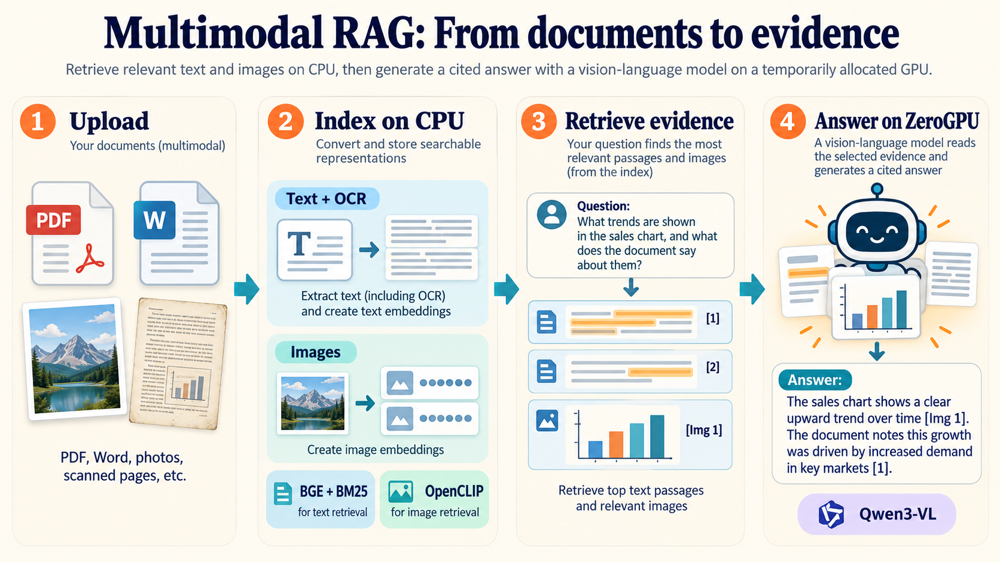
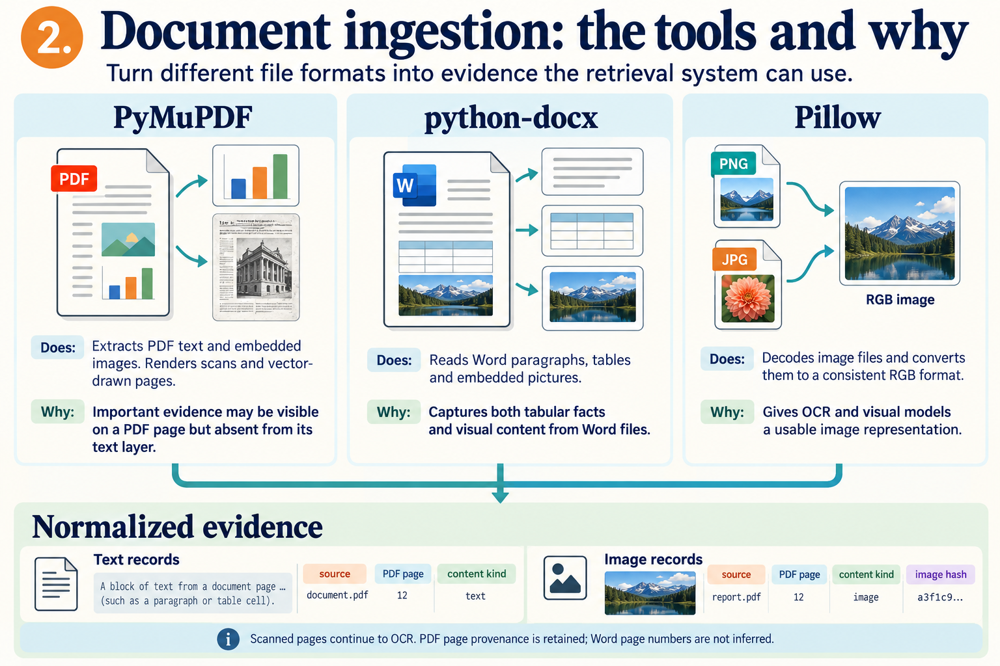
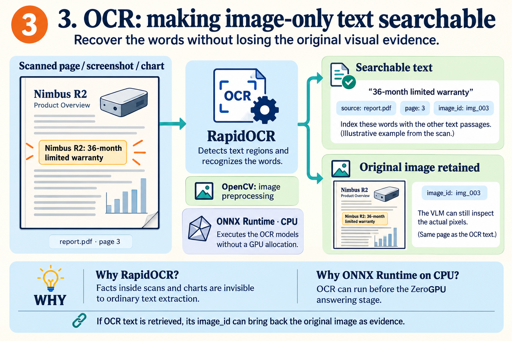
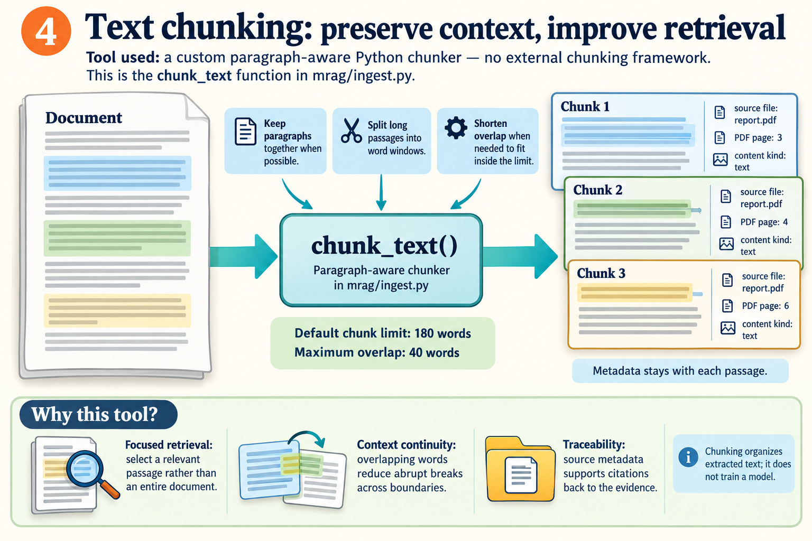
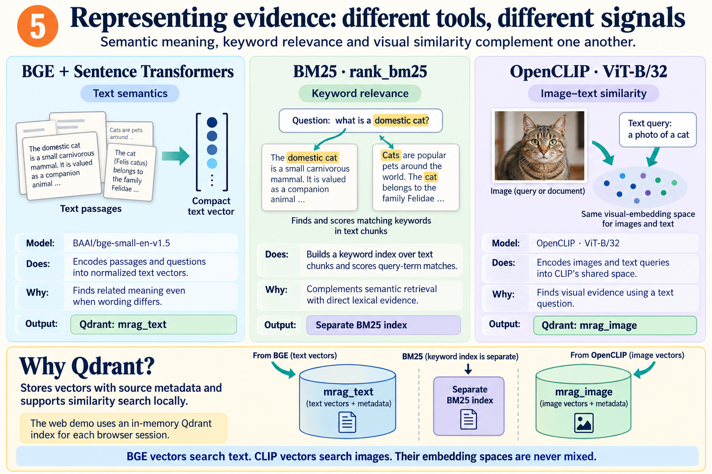
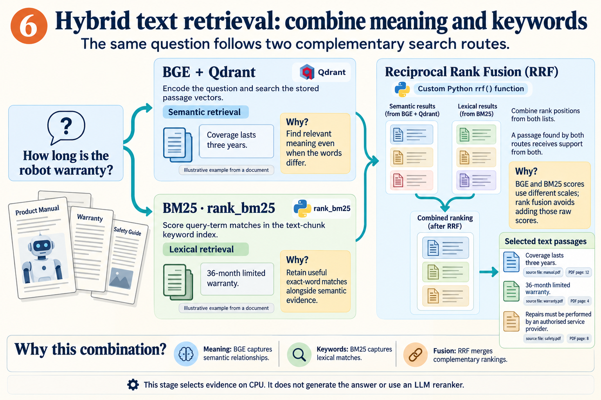
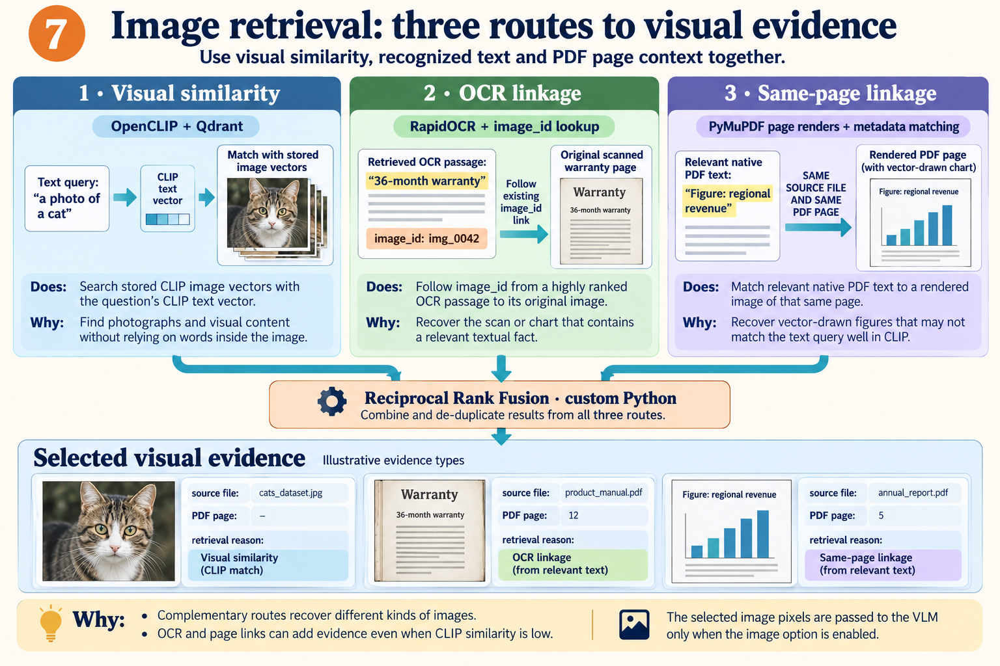
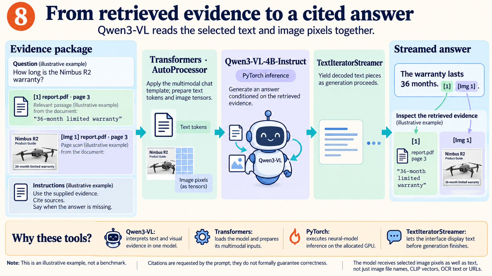
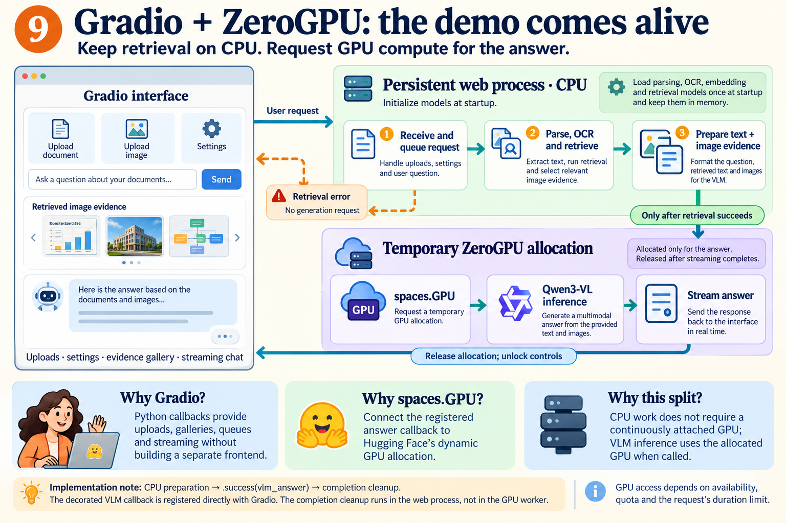
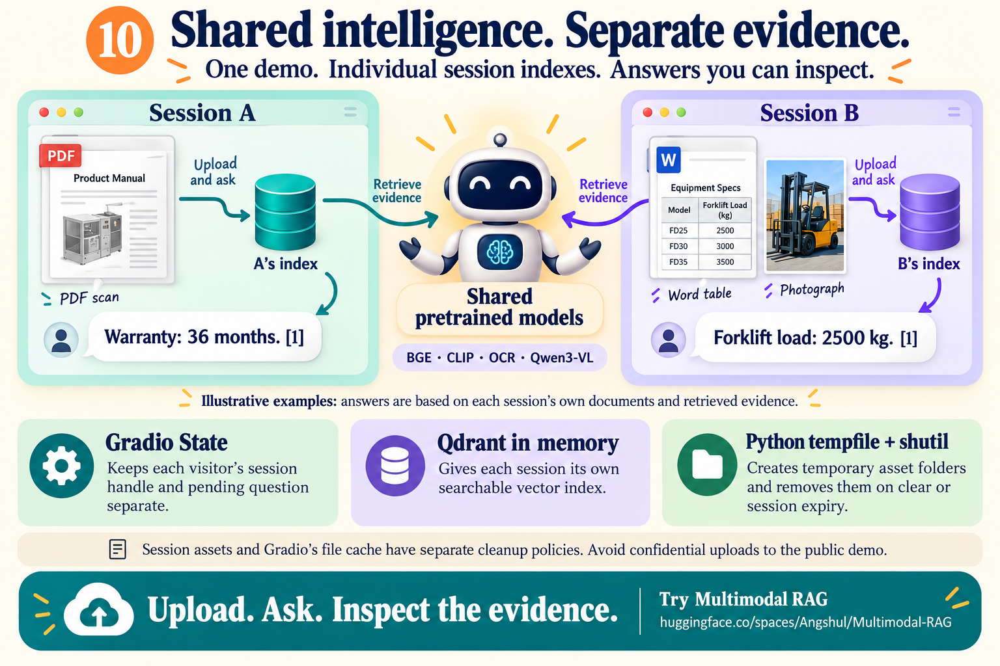

# Build a Multimodal RAG Demo That Reads Text, Scans, Charts and Images

A practical walkthrough of BGE, BM25, OpenCLIP, RapidOCR, Qdrant and Qwen3-VL on Hugging Face ZeroGPU.

**Angshul Majumdar** · Indraprastha Institute of Information Technology Delhi

[Try the running HF demo](https://huggingface.co/spaces/Angshul/Multimodal-RAG)

A useful answer is not always in a document's text layer. It might sit inside a scanned warranty page, a chart, a screenshot or a photograph. A text-only retrieval pipeline can miss that evidence before the language model ever sees the question.

This tutorial follows a working multimodal RAG application from upload to a cited answer. The application uses pretrained models; it does not fine-tune them on the uploaded documents. Parsing, OCR, indexing and retrieval run on CPU. Qwen3-VL receives selected text and image pixels inside a ZeroGPU inference callback.

The ten illustrations below are the figures created for this demo. Their examples are explanatory rather than benchmark results. The accompanying repository contains the application, sample documents, tests and a technical dependency reference.

## 1. Start with two kinds of evidence



Figure 1. CPU retrieval selects text passages and visual evidence before the vision-language model generates an answer.

The pipeline has two distinct jobs. Ingestion turns files into searchable records. At question time, retrieval selects a small evidence package, and generation interprets that package. The model is not asked to read the entire collection for every question.

Text passages have a semantic retrieval route and a keyword route. Images have a CLIP route and links from relevant OCR or native PDF text. These routes meet in the prompt, where the generator sees both numbered text sources and the selected image pixels.

### Tools used, and why

- **BGE and BM25.** Retrieve text using complementary semantic and lexical signals.
- **OpenCLIP and evidence links.** Retrieve photographs, scans and page images using visual similarity or document context.
- **Qwen3-VL.** Read the selected evidence and produce an answer with requested source references.

## 2. Parse the source before choosing a model



Figure 2. PyMuPDF, python-docx and Pillow normalize different file formats while retaining source provenance.

A born-digital PDF may expose native text, embedded raster images and vector drawing commands. A scanned PDF may expose no usable text at all. The loader takes these differences seriously: it extracts native material where possible and renders pages when the visual content would otherwise be lost.

Word documents require a different parser. Paragraphs and tables are read as text, and embedded images are extracted from document relationships. Standalone images are decoded into RGB. The result is a collection of text records and image records with source metadata. PDF page numbers are retained; Word page numbers are not inferred.

### Tools used, and why

- **PyMuPDF.** Extract PDF text and images, rasterize scans, and render pages containing vector drawings. This preserves evidence that plain PDF text extraction misses.
- **python-docx.** Read Word paragraphs, table cells and embedded pictures without reducing the entire file to screenshots.
- **Pillow.** Decode image formats and normalize pixels into a representation the OCR and vision models can consume.

## 3. Make the words inside images searchable



Figure 3. OCR creates a searchable text record while preserving a link to the original image.

Rendering a scanned page creates pixels, not searchable words. RapidOCR detects and recognizes text in those pixels. The recognized text is chunked and indexed alongside native document text, so a question about a warranty can retrieve a fact that existed only in a scan.

The original scan remains an image asset. Its OCR text carries an image_id linking back to that asset. This is important: retrieval can find the words and then bring the corresponding visual into the answer context. Native-text PDF page renders are not OCR'd again because their text layer has already been indexed.

### Tools used, and why

- **RapidOCR.** Recover text from scans, screenshots and image-based chart labels.
- **ONNX Runtime on CPU.** Execute OCR before the GPU answer stage; a ZeroGPU allocation is not needed for OCR.
- **OpenCV.** Provide image-processing operations used by the OCR stack.

## 4. Create passages that retrieval can select



Figure 4. The custom chunker uses a 180-word limit and up to 40 words of overlap. The overlap illustration is conceptual; PDF pages are chunked separately.

Retrieving an entire document gives the generator too much unrelated material. Retrieving a tiny isolated phrase can remove the context needed to interpret it. The chunker therefore uses bounded passages and overlap, while keeping whole paragraphs together when possible.

The defaults are 180 words per chunk and up to 40 words of overlap. Long paragraphs use sliding word windows. When a following paragraph would exceed the limit, overlap is shortened to fit. These settings count words, not model tokens. Every passage retains its source, PDF page where available, and content kind.

### Tools used, and why

- **Custom Python chunk_text().** Implement the paragraph-aware rule directly without an additional chunking framework.
- **Source metadata.** Keep retrieved passages traceable to the file and page from which they were extracted.

```python
from mrag.ingest import chunk_text

chunks = chunk_text(
    extracted_text,
    chunk_words=180,
    overlap=40,
)
```

## 5. Give each signal its own representation



Figure 5. BGE, BM25 and OpenCLIP provide different retrieval signals. Qdrant stores the text and image vectors in separate collections.

BGE-small encodes passages and questions into normalized text vectors. A question can then find a passage whose wording differs but whose meaning is related. BM25 contributes a separate keyword index, useful when names, product identifiers or distinctive terms matter.

OpenCLIP encodes images and text queries into its own shared space. A text query such as a photo of a cat can search stored image vectors without requiring a caption inside the photograph. BGE vectors and CLIP vectors are different representations and are never compared directly.

Qdrant holds two local collections: mrag_text and mrag_image. Each point includes its vector and source payload. In the web demo, a browser session gets its own in-memory Qdrant client and index. BM25 remains a separate keyword index over text payloads.

### Tools used, and why

- **Sentence Transformers + BAAI/bge-small-en-v1.5.** Provide the dense semantic text representation.
- **rank_bm25.** Score token matches without requiring another neural model. The implemented tokenizer lowercases alphanumeric terms; it does not perform stemming.
- **OpenCLIP ViT-B/32.** Support text-to-image similarity search.
- **qdrant-client.** Store vectors with provenance and search them locally, without an external database server.

## 6. Fuse ranks instead of adding incompatible scores



Figure 6. Semantic and keyword searches run on the same question, then Reciprocal Rank Fusion merges their ranked results.

At question time, the application runs BGE/Qdrant search and BM25 search. The candidate lists are complementary, but their raw scores are not on a common scale. Simply adding a cosine similarity to a BM25 score would give an arbitrary meaning to their relative magnitudes.

The custom rrf() function instead uses rank positions. For every list containing a passage, it adds 1 / (60 + rank), with rank starting at 1. A passage supported by both retrievers receives two contributions. The application keeps six text passages by default, from candidate lists of up to 25 each.

This is retrieval fusion, not an LLM reranker. It selects evidence on CPU and introduces no extra model training. Source metadata survives the fusion step.

### Tools used, and why

- **BGE + Qdrant.** Find semantically related passages.
- **BM25.** Retain lexical evidence that dense retrieval may rank differently.
- **Custom Reciprocal Rank Fusion.** Merge the ranked lists without assuming that the retrievers' raw scores are comparable.

## 7. Recover visual evidence through three routes



Figure 7. CLIP similarity, OCR linkage and same-page linkage find different types of visual evidence. The thumbnails illustrate evidence types, not results for one shared question.

The first image route encodes the question with CLIP and searches the image collection. Matches below the configured similarity floor are removed. This route is particularly useful for photographs and recognizable visual content.

The second route follows image_id links from highly ranked OCR passages. It can recover a warranty scan because the extracted words match the question, even if CLIP does not strongly associate the page's appearance with that question.

The third route matches the source file and PDF page of relevant native text to a rendered page image. This recovers vector-drawn charts and figures that do not appear as embedded raster images. The image rankings are fused with RRF, returning up to three images by default.

### Tools used, and why

- **OpenCLIP + Qdrant.** Provide visual similarity retrieval from a text query.
- **OCR metadata lookup.** Bring back an original image through a relevant text passage, without running OCR again.
- **PyMuPDF page renders + source/page matching.** Retain visual figures associated with a relevant PDF page even when CLIP similarity is low.

## 8. Give the VLM pixels, text and citation identifiers



Figure 8. Transformers prepares text tokens and image tensors; Qwen3-VL generates a response; TextIteratorStreamer exposes the text as it is produced.

The prompt contains the question, numbered text sources and identifiers for attached images. Pillow loads and resizes the selected image assets before the model processor converts the text and pixels into multimodal inputs. Supplying only an image path or a CLIP vector would not let the VLM inspect the image itself.

The system prompt asks Qwen3-VL to answer from the supplied evidence, cite passages as [1] or [2], cite images as [Img 1], and acknowledge missing information. Document contents are treated as untrusted data rather than instructions. These are grounding instructions, not a formal correctness guarantee.

PyTorch runs generation, while TextIteratorStreamer yields decoded pieces to the interface. The visible transcript is not used as dialogue memory: each question retrieves fresh evidence and receives an independent answer.

### Tools used, and why

- **Transformers AutoProcessor.** Apply the model's chat template and prepare text tokens, image tensors and associated vision metadata.
- **Qwen/Qwen3-VL-4B-Instruct.** Interpret the selected text and images in one vision-language model.
- **PyTorch + TextIteratorStreamer.** Execute inference and stream the response before the full generation finishes.

## 9. Put the GPU boundary around answering



Figure 9. Gradio coordinates the interface and callback chain. Successful CPU preparation invokes the registered ZeroGPU callback; completion cleanup runs in the web process.

Gradio provides uploads, settings, an evidence gallery and queued streaming callbacks. The web process performs parsing, OCR and retrieval on CPU. The VLM is initialized at module scope with the placement pattern expected by ZeroGPU, rather than being downloaded and loaded inside every answer request.

The GPU-decorated vlm_answer function is registered directly with Gradio. CPU preparation feeds it through a .success(...) event, so failed preparation does not trigger generation. A completion callback in the web process clears pending data and unlocks controls on success or failure.

CPU callbacks and VLM generation use concurrency limits to avoid conflicting operations. A session also has a busy guard, so clearing its index during an answer cannot invalidate its evidence. ZeroGPU access still depends on the visitor's quota, scheduling and the request's duration limit.

### Tools used, and why

- **Gradio.** Build the interactive frontend and connect Python callbacks without a separate web frontend.
- **spaces.GPU.** Connect the directly registered answer handler to temporary GPU allocation on Hugging Face.
- **The CPU/GPU split.** Keep preprocessing and retrieval independent of the allocated GPU; use the GPU for VLM inference.

```python
# Simplified wiring; see app.py for the complete inputs and outputs.
prep = question.submit(prepare_answer, ...)
answer = prep.success(vlm_answer, ...)
answer.then(finish_answer, ...)
```

## 10. Share models, keep session evidence separate



Figure 10. Shared intelligence, separate evidence: each browser session owns its retrieval index and temporary assets while pretrained model objects are reused.

A multi-user demo should not put every visitor's documents into one retrieval index. The Session object therefore creates an independent in-memory Qdrant client, a manifest and a temporary asset directory. Shared model objects avoid loading another BGE, CLIP and OCR stack for every visitor.

Gradio State keeps the session handle and pending values associated with the visitor. Clearing or expiring that state closes the index and removes its asset directory. The configured state TTL is three hours. Gradio separately checks its cache hourly and removes files older than three hours; those are different cleanup paths.

Index isolation is not a guarantee of confidentiality for a public Gradio service. File URLs can outlive a session's cleanup, so the public demo should not receive confidential documents. The useful final habit is simpler: ask a question, then inspect the retrieved evidence behind the answer.

### Tools used, and why

- **Gradio State.** Associate each visitor with the correct session and pending request.
- **In-memory Qdrant clients.** Keep browser-session retrieval indexes independent.
- **tempfile + shutil.** Create temporary assets and remove them on clear or session cleanup.

## Upload. Ask. Inspect the evidence.

To try the full path, open the live demo and load the sample documents. Ask about the Nimbus R2 warranty, the highest-revenue region, the forklift's maximum load, the server-room code schedule and the office-cat photograph. Those examples exercise scans, charts, Word tables, screenshots and image retrieval respectively.

The repository provides a technical README for installation and dependencies, and the implementation can be inspected module by module. The central design choice is to preserve both textual and visual evidence until the final answer stage.

[Open Multimodal RAG on Hugging Face](https://huggingface.co/spaces/Angshul/Multimodal-RAG)
